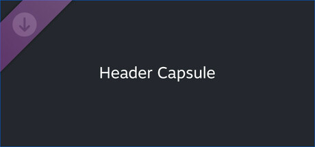

**Silent Hill f by Neobards Entertainment (2025) moves the iconic horror series to 1960s rural Japan.**

---

## 📖 About

Silent Hill f by Neobards Entertainment (2025) moves the iconic horror series to 1960s rural Japan. You play as Shimizu Hinako in a village overtaken by flesh-flower parasites. It is the first mainline Silent Hill since Downpour and carries enormous fan expectations for psychological horror.

## ⚠️ Problems Without Trainer

| Problem | Status |
|---------|--------|
| Save resource management critical as ink ribbons limited in hard mode | ✅ Solved |
| Enemy attack patterns in fog sections invisible until near-lethal range | ✅ Solved |
| Ammo scarcity forces uncomfortable melee combat with weak starting weapons | ✅ Solved |
| Puzzle solutions tied to Japanese cultural knowledge not telegraphed in-game | ✅ Solved |
| Parasite enemy variants resist melee weapons requiring specific ammo types | ✅ Solved |

## ✅ Solution

The **Silent Hill f Trainer** solves all these issues, giving you complete control so you can focus on enjoying the game.

## 🎯 Features

- Unlimited Resources / Currency
- God Mode / Invincibility
- Instant Skill & Ability Cooldown
- One-Hit Kill
- Freeze Timers
- Unlock All Items & Achievements
- Custom Speed Multiplier
- Infinite Stamina / Energy

## 🚀 Quick Start

1. **Disable Windows Defender** temporarily (trainer may trigger false positive)
2. Get the trainer from the button above
3. Launch Silent Hill f
4. Run the trainer as Administrator
5. Use the hotkeys to activate cheats in-game

## 💎 Free vs Pro

| Feature | Free | Pro |
|---------|------|-----|
| God Mode | ✅ | ✅ |
| Unlimited Resources | ✅ | ✅ |
| Advanced Cheats | ❌ | ✅ |
| Auto-Updates | ❌ | ✅ |
| Priority Support | ❌ | ✅ |

## 💻 Requirements

- Windows 10 / 11 (64-bit)
- Silent Hill f (any version)
- .NET Framework 4.8+
- DirectX 11+

## 🍎 macOS

## ⚖️ Legal

Educational and single-player use only.

---

